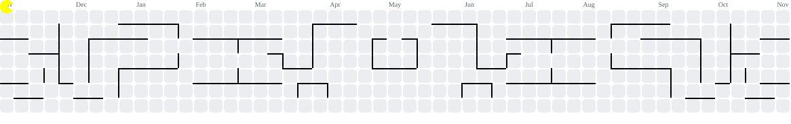

  <h1>Hey 👋 What's Up?</h1>
  <h2>Lakshith Reddy</h2>
  
<strong>AI & ML Undergraduate · AI Agents · Developer Tools · Security Engineering</strong>

  
Think disruptive. Build relentlessly.

  

    
  

  

    
    
    
    
    
    
  

  

    
  

<table width="100%" border="0">
  <tr>
    <td width="68%" valign="top">
      <h2>About me</h2>
      

        I'm a B.Tech student in
        <strong>Artificial Intelligence & Machine Learning at Malla Reddy Vishwavidyapeeth</strong>.
        I build AI-powered applications and developer tools that solve practical
        problems, make systems safer, and produce results that can be verified—not just claimed.
      

      <ul>
        <li>
          🤖 <strong>AI engineering:</strong>
          AI agents, tool execution, reasoning workflows, and autonomous coding systems.
        </li>
        <li>
          🛡️ <strong>Developer security:</strong>
          Credential detection, static analysis, and privacy-focused tooling.
        </li>
        <li>
          🧩 <strong>Product engineering:</strong>
          Full-stack applications, workflow automation, and practical software products.
        </li>
        <li>
          🚀 <strong>Leadership:</strong>
          Managing Director at
          <a href="https://flyaxisoverseas.com/">Fly Axis Overseas</a>.
        </li>
      </ul>
    </td>
    <td width="32%" valign="middle" align="center">
      
    </td>
  </tr>
</table>

## Tech stack

  

## GitHub contribution streak

  <picture>
    <source
      media="(prefers-color-scheme: dark)"
      srcset="https://streak-stats.demolab.com/?user=MokuLakshithReddy&theme=dark&timezone=Asia%2FKolkata"
    />
    
  </picture>

## Achievements

<table align="center" width="100%">
  <tr>
    <td align="center" width="25%">
      <h3>🚀 Open VSX</h3>
      <a href="https://open-vsx.org/extension/MokuLakshithReddy/secret-leak-detector">
        Published Extension
      </a>
       
      Secret Leak Detector
    </td>
    <td align="center" width="25%">
      <h3>🏆 4 Merged PRs</h3>
      <a href="https://github.com/MokuLakshithReddy?tab=repositories">
        Upstream Contributions
      </a>
       
      Apache · Photocraft · XERJ · Libreswan
    </td>
    <td align="center" width="25%">
      <h3>🧠 XERJ Corpus</h3>
      <a href="https://hub.xerj.org/contributors/MokuLakshithReddy">
        Corpus Contributor
      </a>
       
      CampusConnect · AI Agent Reference
    </td>
    <td align="center" width="25%">
      <h3>🔄 1 Open PR</h3>
      <a href="https://github.com/modelcontextprotocol/typescript-sdk/pull/3003">
        MCP TypeScript SDK
      </a>
       
      RFC 6570 URI-template support
    </td>
  </tr>
</table>

## Contribution Arcade

  <picture>
    <source
      media="(prefers-color-scheme: dark)"
      srcset="https://raw.githubusercontent.com/MokuLakshithReddy/MokuLakshithReddy/output/pacman-contribution-graph-dark.svg"
    />
    <source
      media="(prefers-color-scheme: light)"
      srcset="https://raw.githubusercontent.com/MokuLakshithReddy/MokuLakshithReddy/output/pacman-contribution-graph.svg"
    />
    
  </picture>

  Powered by my GitHub contributions. Keep coding, keep playing! 👾

## Featured projects

<table>
  <tr>
    <td width="50%" valign="top">
      <h3><a href="https://open-vsx.org/extension/MokuLakshithReddy/secret-leak-detector">🛡️ Secret Leak Detector</a></h3>
      
A VS Code extension and CLI for finding potential credential leaks, with multiple detection signals and Git-hook protection.

      
TypeScript · VS Code · CLI · GitHub Actions

      <a href="https://open-vsx.org/extension/MokuLakshithReddy/secret-leak-detector">Open VSX Extension</a> ·
      <a href="https://lakshith-s-portfolio.vercel.app/#evidence">Evidence & Benchmarks</a>
    </td>
    <td width="50%" valign="top">
      <h3><a href="https://lakshith-s-portfolio.vercel.app/#projects">⚙️ Local AI Execution Agent</a></h3>
      
A local-first, model-agnostic execution framework focused on bounded tools, human approvals, and independent verification.

      
Python · FastAPI · React · SQLite

      <a href="https://lakshith-s-portfolio.vercel.app/#evidence">Evidence & Verification</a>
    </td>
  </tr>
  <tr>
    <td width="50%" valign="top">
      <h3><a href="https://lakshith-s-portfolio.vercel.app/#projects">🤖 Autonomous AI Coding Orchestrator</a></h3>
      
A closed-loop coding system coordinating planning, code changes, independent verification, and repair when checks fail.

      
TypeScript · Node.js · Fastify · React · SQLite

      <a href="https://lakshith-s-portfolio.vercel.app/#evidence">Evidence & Benchmarks</a>
    </td>
    <td width="50%" valign="top">
      <h3><a href="https://lakshith-s-portfolio.vercel.app/#projects">🧠 ThinkMate</a></h3>
      
A personal AI thinking partner that guides users through understanding problems, exploring alternatives, challenging assumptions, deciding, and acting.

      
Next.js · TypeScript · Supabase · Gemini

      <a href="https://lakshith-s-portfolio.vercel.app/#projects">Project showcase & architecture</a>
    </td>
  </tr>
  <tr>
    <td width="50%" valign="top">
      <h3><a href="https://github.com/MokuLakshithReddy/PrivacyLens">🔎 PrivacyLens</a></h3>
      
A local research prototype comparing privacy-policy claims with observed browser network metadata. Findings are heuristic signals, not legal or safety verdicts.

      
TypeScript · Browser Extensions · Python · FastAPI

      <a href="https://github.com/MokuLakshithReddy/PrivacyLens">Repository</a> ·
      <a href="https://github.com/MokuLakshithReddy/PrivacyLens/blob/main/docs/production-readiness-status.md">Readiness & limitations</a>
    </td>
    <td width="50%" valign="top">
      <h3><a href="https://github.com/MokuLakshithReddy/campus-connect">🎓 CampusConnect</a></h3>
      
A college community platform for club workspaces, announcements, events, and student collaboration.

      
React · TypeScript · Vite · Supabase

      <a href="https://github.com/MokuLakshithReddy/campus-connect">Repository</a> ·
      <a href="https://hub.xerj.org/corpus/mokulakshithreddy--campus-connect">XERJ Corpus Index</a> ·
      <a href="https://github.com/MokuLakshithReddy/campus-connect/releases">Releases & Android build</a>
    </td>
  </tr>
  <tr>
    <td width="50%" valign="top">
      <h3><a href="https://github.com/MokuLakshithReddy/PiggyBack">🚚 PiggyBack</a></h3>
      
A logistics optimization project exploring shipment recovery and the use of available freight capacity and alternative routes.

      
Next.js · TypeScript · GIS · Leaflet

      <a href="https://github.com/MokuLakshithReddy/PiggyBack">Repository & testing notes</a>
    </td>
    <td width="50%" valign="top">
      <h3><a href="https://github.com/MokuLakshithReddy/AstraLab">🧪 AstraLab</a></h3>
      
An AI-powered chemistry simulation prototype that combines interactive reaction visualizations with real-time hazard detection.

      
JavaScript · HTML5 Canvas · Heuristic Rules · Educational Tech

      <a href="https://github.com/MokuLakshithReddy/AstraLab">Repository</a> ·
      <a href="https://lakshith-s-portfolio.vercel.app/#projects">Portfolio showcase</a>
    </td>
  </tr>
</table>

## Open-source contributions

Selected contributions to upstream projects:

| Project | Contribution | Status |
|---|---|---|
| [Apache Fineract #149](https://github.com/apache/fineract-consumer-facing/pull/149) | Added correlation ID support across frontend and backend. | ✅ Merged |
| [Photocraft #1141](https://github.com/storytold/photocraft/pull/1141) | Added nearest-neighbor sampling for image reductions. | ✅ Merged |
| [XERJ #1804](https://github.com/xerj-org/xerj/pull/1804) | Fixed parsing for standalone and infix query operators. | ✅ Merged |
| [Libreswan docs #7](https://github.com/libreswan/libreswan.github.io/pull/7) | Added generated page titles to the default layout. | ✅ Merged |
| [MCP TypeScript SDK #3003](https://github.com/modelcontextprotocol/typescript-sdk/pull/3003) | Proposed RFC 6570 URI-template prefix modifier support. | 🔄 Open when reviewed (Oct 30, 2026) |

## A little more about me

| | |
|---|---|
| 🎓 **Education** | B.Tech, Artificial Intelligence & Machine Learning — Malla Reddy Vishwavidyapeeth, Hyderabad. |
| 💼 **Current role** | Managing Director — [Fly Axis Overseas](https://flyaxisoverseas.com/). |
| 🔭 **Exploring** | AI agents, autonomous software engineering, secure tool execution, privacy engineering, and system verification. |
| 🤝 **Interested in** | Engineering collaborations, open-source projects, and building practical products. |

## Let's connect

  
  
  
  

  <strong>Think disruptive. Build relentlessly.</strong> 
  Thanks for stopping by. Keep learning, keep building. 👋

